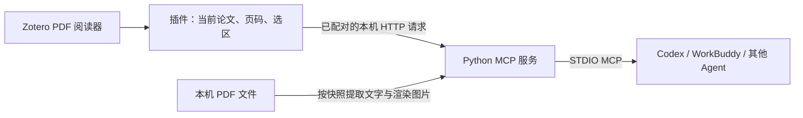

# Agent Reader Bridge：Zotero 阅读上下文 MCP

让本地 AI Agent 知道你正在 Zotero 中读哪篇论文、看哪一页、选中了什么，并通过标准 MCP 工具读取论文正文、搜索内容和查看页面图片。

项目由 **极简 Zotero 插件 + Python STDIO MCP 服务**组成。无需配置模型 API Key，不自带聊天界面。可接入 Codex、WorkBuddy，以及其他支持本地 STDIO MCP 的 Agent。

> 当前版本 0.1.3；真实环境验证为 Windows + Zotero 10.0.6。其他系统与 Zotero 大版本尚未验证。发布的是源码，用户须在本机生成配对插件，不能共享别人构建的 XPI。

## 功能

| 能力 | 说明 |
|---|---|
| 当前论文 | 返回标题、文档标识、阅读器标识、PDF 总页数 |
| 当前页 | 返回从 1 开始的物理 PDF 页码、页标签和分屏视图 |
| 临时选区 | 读取选中文字、选区所在物理页及位置，不要求先保存为批注 |
| 指定页正文 | 按快照读取连续页面，单次最多 10 页 |
| 全文搜索 | 在当前论文中进行忽略大小写的字面搜索 |
| 页面图片 | 将指定页渲染为 PNG，便于 Agent 检查图表和公式 |
| 文档快照 | 本轮问答绑定同一份 PDF，避免用户切换标签后读错论文 |
| 继续已有对话 | 客户端加载 MCP 后可在已有聊天中调用，无需插件建立另一套聊天记录 |

不包含翻译、双语 PDF、OCR、文献下载、库管理、自动回复或模型服务。翻页和选中文字不会自动触发推理；Agent 在你提问时读取状态。

## 工作方式



插件通过 Zotero connector 的回环端口提供认证端点。MCP 服务读取本机 PDF，Agent 自身负责模型调用。此项目不提供额外云端上传服务，但 Agent 读取到的论文内容仍可能按其设置发送至模型提供方。

## 安装与开始使用

详细教程：[安装与客户端接入](docs/INSTALL.md)。

1. 安装 Zotero 10、Python 和本项目依赖。
2. 在项目内运行 `build.py`，生成一套新的配对凭证、XPI 和客户端配置。
3. 在 Zotero“工具 → 插件 → 齿轮 → 从文件安装插件”中安装生成的 XPI。
4. 把 `dist/codex-config.toml` 或 `dist/agent-config.json` 中的配置合并到 Agent 的 MCP 设置。
5. 重新加载客户端，打开论文，然后提问：

> 用 zotero_reader 读取当前论文，解释我选中的内容，并引用原始 PDF 页码。每个新问题先获取最新阅读上下文，再复用同一个 snapshot_id 读取正文。

安装 MCP 不等于当前聊天已加载工具。有些客户端需要完全退出并重启，再回到原聊天；无需因此删除或新建对话。

## 四项 MCP 工具

| 工具 | 参数 | 结果与限制 |
|---|---|---|
| `get_reading_context` | 无 | 当前论文、物理页、选区、`snapshot_id`、总页数等 |
| `read_pages` | `snapshot_id, first_page, last_page` | 单次最多 10 页，正文总量最多 60000 字符，标注截断 |
| `search_paper` | `snapshot_id, query, limit=10` | 字面忽略大小写搜索，最多 30 个片段；不是语义搜索 |
| `get_page_image` | `snapshot_id, page` | 最长边不超过 1600 像素 PNG；客户端须支持图片工具结果 |

完整语义和问答范例见 [工具使用与常见问题](docs/USAGE.md)。

**选区页码优先。** 连续滚动时，顶层 `page` 是 Zotero 保存的视口锚点，可能属于上一张部分可见页面。解释选区应读取 `selection.pages`，不能直接拿 `page` 替代。

快照存在于当前 MCP 进程内，最多 32 个，有效期 1 小时。服务重启后失效，不可跨 Agent 进程复用。后续读取校验 PDF 的 SHA-256；文件改变、删除或快照过期时应重新获取上下文。

## 已验证范围

- Codex 原有聊天已实际调用全部四项工具，读取论文并回答问题。
- Zotero 临时选区曾验证为：视口锚点第 2 页、选区实际第 3 页，成功读取非空选中文字。
- WorkBuddy 国际版桌面 MCP 连接及四项工具发现成功；使用其 CLI 引擎显式挂载 MCP 后，四项实际调用及中文回答成功。本轮 CLI 选区为空，未验证非空选区。
- CCB 的首轮任务能回收回复，后续派发遇到 `delivering` 阻塞，**未验证完整 CCB 队列链路成功**。也未验证通过桥接接管 WorkBuddy 桌面已有聊天。
- 自动测试覆盖模拟 Zotero 状态、真实 PDF、真实 MCP SDK 子进程，以及插件适配器与安装清单。自动测试不能代替真实客户端验收。

## 隐私与配对文件

以下文件只应留在本机，已由 `.gitignore` 排除：

- `runtime.json`：本机配对令牌。
- `plugin/secret.js`：构建时生成的插件令牌。
- `dist/*.xpi`：内含上述令牌，不能作为通用发行附件上传。
- 生成的客户端配置、论文输出、页面图片和日志。

本项目不会把开发者机器的配对文件、用户名、论文全文或诊断日志上传到仓库。若本机令牌泄露，应生成新配对并同步重装插件。请勿在 Issue 中粘贴令牌、私有论文、完整运行日志或模型密钥。

## 开发与测试

依赖安装后，在仓库目录执行：

```powershell
New-Item -ItemType Directory -Force tmp | Out-Null
python -B -m unittest discover -s tests -p "test_*.py"
node --test tests/adapter.test.cjs tests/bootstrap.test.cjs tests/context-source.test.cjs
```

`plugin/adapter.js` 集中封装 Zotero 内部阅读器字段。Zotero 升级后需回归验证页码、选区、多个阅读窗口与标签切换。

## 许可与第三方依赖

本仓库尚未指定项目源码的开源许可证；公开可见不代表授予任意再分发许可。第三方依赖保留各自许可证，依赖清单见 `requirements-lock.txt`。PyMuPDF 提供 AGPL / 商业许可；分发或集成前请查阅其适用条款。本仓库不捆绑第三方二进制依赖。
